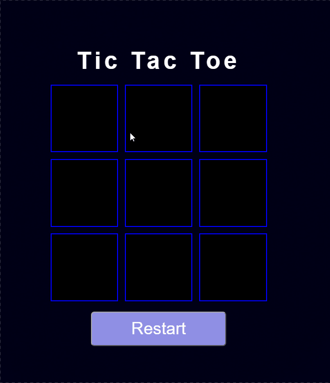
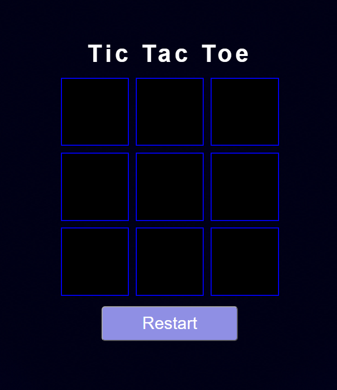

### Tic Tac Toe
it is the tic tac toe game where you can play with the computer for the timepass.

here's an AWESOME gif of my project!
;


## HOW THIS WAS MADE
i made this because we play this game in our school. and i thought why not to make this game now with my coding knowledge and i made it .

## What does it do
we can play the game with the computer and get the joy of winning and losing.

### Tech stack
1. Html
2. Css
3. javascript

## Demo Link
[Here is live demo of my project](https://tic-tac-toe-virid-eight-80.vercel.app/)

### Development

1. Clone the source code to your device
```sh
git clone https://github.com/Saurav-Khanal/Tic-Tac-Toe.git
```

2. Open the project folder

3. Open `index.html` in your browser

## Screenshots
;

## Problem i faced
this game logic was simple so here i didnt face much problem .
but i forget some syntax that why i use documentation to remind the syntax.


## AI DISCLOSURE

i used Ai to generate the winning pattern array.


